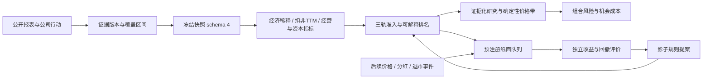

# 选股质量、证据与效果验证设计

日期：2026-10-22

状态：完整设计评审稿；优化方向已获用户同意，本文细节尚未逐项确认；未实施、未激活新尺子。

方法：Superpowers `brainstorming` → `writing-plans` → `verification-before-completion`。

开发文档：[实施计划](../plans/2026-10-22-selection-quality-and-validation-plan.md)。

## 1. 目标与范围

把现有三轨发现升级为可以解释、复现、检验的投资研究闭环。保留优质折价、深度价值、GARP 三种独立逻辑，纠正排名与财务口径，识别当期经营变化，用可核证据形成研究结论，并独立记录后续表现。

本轮覆盖此前评估中获同意的全部六组建议。按四个里程碑组织，禁止把只完成排序修复称作整轮完成：

| 里程碑 | 交付 | 依赖与边界 |
|---|---|---|
| M1 可信计算 | 并列排名、经济稀释、净现金排序、季度冻结、扣非 TTM | 先建立证据合同；需要新数据的门槛在覆盖率通过后统一启用 |
| M2 经营与兑现 | 当期确认、资本回报、回款与资金可用性、分红回购 | 不新增万能总分；新增但未验证的信号进入影子观察 |
| M3 独立验证 | 前瞻纸面组合、历史数据导入与重放、基准与消融比较、规则进化隔离 | 引擎可以验收，3/6/12 个月实际结果必须等待期限到达 |
| M4 研究与组合 | 证据化深研、可复算价格带、共同风险暴露、页面与发布 | 复用 M1/M2 的事实，使用 M3 的独立结果；不自动交易 |

不在本轮：新增交易券商接口、付费数据订阅、分钟择时、收益承诺、扩展北交所/港美股、重建指数基金筛选算法。指数基金作为机会成本参照，保留原模块的口径与风险提示。

### 1.1 全局约束

- Python `>=3.12,<3.15`；Node `^22.18.0 || >=24.12.0`；沿用 FastAPI、SQLAlchemy、SQLite、Vue 3、TypeScript、pytest，不新增运行时依赖。
- 金额使用人民币元、股数使用股、内部增长率使用小数、现有 ROE/毛利率输入使用百分数；单位转换仅在明确的边界函数发生。
- 金融计算使用有限 `Decimal`；JSON 中新增金融数值写十进制字符串，禁止 NaN、Infinity 和二进制浮点排序。
- 业务日历使用 `Asia/Shanghai`，持久化时间使用带时区 UTC；日期值不得冒充精确公告时间。
- 不修改已经冻结的批次、尺子、证据、原始报表和已发布跟踪配置；修订一律追加版本并关联被修订记录。
- 缺失、不适用、来源不可信、确认为零是四种不同状态；任何一种都不得静默变成“无风险”。
- 测试只使用临时库和去标识 fixture；禁止对 `data/app.db` 运行测试、迁移演练、删库或重建。
- 三轨只输出研究资格；纸面组合、研究结论和仓位提示不产生真实交易指令。
- 每个改变准入、排序、风险等级、价格带或组合约束的参数都必须进入版本化配置和输入指纹。

## 2. 当前证据与需要改变的行为

核查基线：HEAD `3c6a063`，工作区有既存未跟踪文件；本次只创建本文与实施计划，不改变业务代码或数据库。

2026-10-22 只读查询显示：最新 run 8，`2026-W43`，`discovery-v7`，fill 11（10 月 16 日），尺子 21/22/23。三轨门槛通过 24/32/19 家，最终各 15 家。关联发现批次的 12 份研究中 10 份为 C 级信息；本周三份均为 C。本周 15 家 GARP 的资本回报标签全部是 `roe_fallback`。这些是覆盖率与流程证据，不是收益证据。

| 现状 | 代码证据 | 新行为 |
|---|---|---|
| 每维度排序后 enumerate，缺失/同值被代码拆开 | `discovery/competition.py:rank_borda_competition` | 并列中位名次，常量维度不计分，代码只用于最终完全同分 |
| 银行/非金融混用排序字段；非金融 PB 分位常为空 | `discovery/rulers.py`、`scripts/calibrate_discovery.py` | 分支声明适用维度，在分支内归一化后合并 |
| 股本末值/初值作为稀释 | 三个 `discovery/tracks/*.py` | 剥离送转/拆合股；发行、注销单列；未解释变动不能当安全 |
| 净债务/FCF 越负越优 | `discovery/tracks/deep_value.py` | 正债务负担与净现金价值分别计算，FCF 收益率独立判断 |
| 竞争阶段读可变 Financial 表计算季度标记 | `jobs/discovery.py:_track_candidates` 的 Financial 查询 | 竞争只读冻结事实，实时行情与研究另建版本 |
| GARP 用普通 PE 除以扣非历史增长 | `discovery/tracks/garp.py:_metric_values` | 当前绝对估值与 PEG 使用扣非 TTM，历史普通 PE 分位明确分开 |
| ROE 回退为 ROIC | 同上 | 真实资本回报与 ROE 标签分开，禁止隐式替代 |
| 模型深研失败被当成误选、灰色被保护 | `scripts/evolve_rulers.py` | 模型标签只生成假设，不能自动激活门槛 |
| 研究价格带来自模型文本 | `research/evaluate.py`、`research/thesis.py` | 数字由确定性估值函数计算，模型解释和质疑假设 |

最小排名复现：三家公司 `(x,y)` 为 `(3,3)、(2,1)、(1,2)`，均越低越好；当前仅 x/y 时顺序 003、002、001，增加全为空的 PB 后变为 002、003、001。新增空信息不应改变经济排名。

## 3. 方案比较与选择

1. **分层纠偏与独立跟踪（采用）**：复用抓取、冻结、三轨和研究界面，把事实、计算、决策、事后结果分开。成本主要在数据合同和迁移，能逐项证明改动价值。
2. **仅继续收紧阈值**：改动少，但无法解决送转误伤、实时数据混入旧批次、模型标签自我强化，拒绝采用。
3. **整体重写为因子平台**：灵活，但引入大量与现有个人研究流程无关的基础设施，拒绝采用。

M1/M2 的新逻辑在候选构建 `discovery-v8` 下联调，不在 v7 同名版本里改变语义。M3 可独立记录已发布的 v7 结果，但只能标为观察性历史队列，不追认成预注册实验。

## 4. 架构与模块边界

K→E 只表示发布新版本的候选路径；不能依据模型标签或尚未成熟的结果自动改变 E。

新增模块按职责分解，不继续往 `jobs/discovery.py` 和 `research/thesis.py` 堆计算：

| 模块 | 责任 |
|---|---|
| `market/evidence.py`、`market/corporate_actions.py` | 证据封装、事件来源、适配与核验；没有策略判断 |
| `discovery/fundamental_types.py`、`discovery/evidence_store.py` | 新 DTO、追加式证据库、覆盖合同 |
| `discovery/fundamentals.py` | 期间转换、TTM、当期确认、ROIC、回款与现金指标的纯函数 |
| `discovery/capital_actions.py` | 送转调整、经济稀释与股本衔接 |
| `discovery/ranking.py` | 分支适用维度、并列名次、可解释贡献；复用原竞争名额逻辑 |
| `research/evidence.py`、`research/valuation.py` | 证据引用校验、等级、情景估值；模型不能改写计算结果 |
| `research/shareholder_return.py`、`ledger/exposure.py` | 股东兑现和组合共同风险 |
| `tracking/` | 配置、行情事件、队列、账本、收益、对照、历史导入；独立于研究结论 |
| `app/selection_models.py`、`app/tracking_routes.py`、`jobs/tracking.py` | 新表、接口、任务；数据库迁移仍由 `app/db.py:init_db` 管理 |

`tracking` 须加入 `pyproject.toml` 的 wheel packages。既有旧 API 保持可读；新 API 和字段采用明确版本，不用空字典伪装成功。

## 5. 事实、时间与存储合同

### 5.1 证据与来源

每个 `EvidenceRecord` 包含 `evidence_id/code/kind/period/published_at/observed_at/source_updated_at/source_url/document_sha256/values/status/basis_id/supersedes_id`。`values` 是规范化字段→字符串或空值的映射；单位、合并口径与期间类型由字段字典定义，basis_id标识已核实可比较的合并范围与会计基础。证据 ID 是除evidence_id本身外全部规范化字段的SHA256，不以股票名称为主键；文档SHA256与证据ID分别保留。

状态固定为 `verified/missing/untrusted/not_applicable`；只有 `verified` 能参与关键门槛。来源合同另存 `CoverageWindow(code, kind, start, end, complete, evidence_ids)`：查询成功且覆盖完整才能证明某段期间无送转、无增发或无分红；请求失败或只拿到最新 8 条公告均不等于无事件。

对数据源不作未经验证的承诺：复用东方财富报表适配器和巨潮公告定位；新增字段必须以实际返回 fixture 和官方报表逐项对照后写入字典。受限资金、关联方占用、账龄、注销执行等若结构化源不提供，使用带官方 URL、文件摘要、页码/表名的规范化 JSON 证据导入。模型抽取结果先是 `untrusted`，核验后追加 `verified` 记录；不得直接参与门槛。

### 5.2 时间边界与修订

`published_at` 代表该版本正式公开时间；`observed_at` 是本系统首次取得时间；`source_updated_at` 不是公告时间。日期精度公告保守视为该日结束后可用。生产选择使用 `available_at = max(published_at, observed_at)`，只纳入 `available_at <= decision_cutoff_at` 的版本。

明确区分 `market_as_of`（价格交易日）、`decision_cutoff_at`（输入事实封口时间）、`published_run_at`（名单最终发布）。周末/周一补取的信息不能声称上周五已经获知；纸面入场必须在 `published_run_at` 之后。

历史档案若能证明“当时公开的原版本”，可使用 `published_at` 作为历史可得时间，但必须带 `archive_verified=true`、原文件摘要与验证来源；今天拉到的重述报表不能因此回填旧时点。历史模式未满足此条件返回 `historical_evidence_unavailable`，不能展示回测收益。

### 5.3 持久化与冻结

新增表：`fundamental_evidence`（事实版本）、`fundamental_coverage`（查询区间版本）、`selection_research_assumptions`（估值假设版本）、`portfolio_exposure_versions`（映射/上限版本）、`strategy_experiments`、`strategy_cohorts`、`strategy_members`、`strategy_market_events`、`strategy_ledger_entries`、`strategy_observations`。

所有表由 `app/selection_models.py` 声明；证据、覆盖、假设、实验配置与账本为追加式。队列状态可以更新，但其成员、配置、来源 run 与规则指纹在注册后不可变。观测结果按 `(cohort_id, horizon_months, calculation_version, event_digest)` 唯一，重试不重复记账。

公司载荷 `SCHEMA_VERSION=4` 保留 `financial_history` 的年度合同，新增独立的 `interim_history`、`capital_events`、`fundamental_extensions`、`coverage`、`evidence_ids`；新字段共同进入公司、财务和批次指纹。季度计算从这些冻结字段读取，竞争阶段不再查询可变 `Financial`。

旧 schema 3、v7 及更早批次只读保留。v8 不用旧快照补几列伪装完整；启动新 fill。旧数据不删除、不重算、不回写新标记。

### 5.4 新表最小列与键

除另述外，id为SQLite整数主键；时间列为UTC，数值金额列为Decimal文本，JSON规范化存TEXT。FK明确RESTRICT，删除用户或旧批次不得级联删除历史证据。

| 表 | 必需列/唯一性 |
|---|---|
| fundamental_evidence | evidence_id TEXT PK，DTO全部列，values_json，available_at；(code,kind,period,available_at)索引；supersedes_id自引用 |
| fundamental_coverage | id，code，kind，start_date，end_date，complete，evidence_ids_json，created_at，digest UNIQUE |
| selection_research_assumptions | id，user_id，code，created_at，method，payload_json，evidence_ids_json，digest UNIQUE |
| portfolio_exposure_versions | id，user_id，created_at，labels_json，policy_json，evidence_ids_json，digest UNIQUE |
| strategy_experiments | id，registered_at，kind，protocol_version，config_json，config_hash，registration_hash UNIQUE；kind区分prospective与retrospective_observation |
| strategy_cohorts | id，experiment_id FK，run_id FK，track，variant_id，published_run_at，registered_at，manifest_json，input_hash，state；(experiment_id,run_id,track,variant_id) UNIQUE |
| strategy_members | cohort_id FK，code，initial_weight，gate_result_id，selection_reason；(cohort_id,code) PK |
| strategy_market_events | event_id TEXT PK，economic_event_id，code，type，effective_at，observed_at，source_id，payload_json，digest，supersedes_id；同一经济事件只采用某个cutoff下最后有效版本 |
| strategy_ledger_entries | id，cohort_id FK，horizon_months，event_id FK，entry_kind，sequence，shares_after，cash_after，receivable_after，cost，calculation_version；(cohort_id,horizon_months,event_id,entry_kind,calculation_version) UNIQUE |
| strategy_observations | id，cohort_id FK，horizon_months，as_of，state，metrics_json，event_digest，calculation_version；(cohort_id,horizon_months,as_of,calculation_version,event_digest) UNIQUE |

实际为10张新增表；应用模型的数量以此表为准。注册HTTP不接收用户指定的registered_at，服务时钟产生该值；测试通过注入时钟构造历史情景。修订事件需新的calculation_version或event_digest，旧计算不变；人工现金结算也是有来源的事件。

## 6. 排名合同（R01、R02）

先按业务分支确定适用维度，在同分支候选内比较，再合并。每条轨道没有跨轨总分。分支间的归一化分数只是研究排队指标，不解释为收益预测或绝对质量可比。

对一个适用维度：先统一数值类型和方向；相同数值取得占用名次的平均值；`rank_pct=(midrank-1)/(n-1)`。`n=1` 返回 0.5。全为空、或所有候选完全同值的维度删除；部分缺失按并列最差名次处理，保留缺失原因。某分支不适用的字段不加入该分支维度集合。

维度等权平均得到 `rank_score`，不是名次总和；没有有效维度时为 0.5 并提示 `ranking_uninformative`。排序依次为明确的风险等级、rank_score、代码。代码不得参与任何维度名次或贡献值。风险等级与信号类型绑定，不按重复的风险文本条数惩罚。

| 轨道/分支 | 计分维度（方向） |
|---|---|
| 优质折价/非金融 | 普通 PE 历史分位↑、ROE 下行波动↑、现金转换率↓ |
| 优质折价/周期 | PB 历史分位↑、正常化 PE↑、现金转换率↓ |
| 优质折价/银行 | PB 历史分位↑、ROE 均值↓、核心一级资本充足率↓ |
| 深度价值/非金融 | 正常化 PE↑、正债务负担↑、正常化 FCF 收益率↓、可用净现金/市值↓ |
| 深度价值/银行 | PB 历史分位↑、ROE 均值↓、不良率变化↑ |
| GARP | 持续增长期数↓、扣非 PEG↑、资本回报↓、现金转换率↓ |

↑ 表示从低到高优先，↓ 表示从高到低优先。深度价值不再同时把 PE 档位和原始 PE 算作两份独立贡献。

保留每轨最多 15 家、每申万二级行业最多 2 家。额外输出适用维度、并列名次、每维贡献、风险状态、名额排除原因。未知行业仍为数据不足。风险层顺序为 `clear < watch < unknown < deteriorating`；重大已核实风险在准入时处理，不靠其他高分抵消。改善/稳定均归 clear，不因为增长快重复加分。

## 7. 经济稀释与现金安全（R03、R04）

### 7.1 经济稀释

事件种类固定为 `split/bonus/consolidation/issuance/rights_issue/stock_compensation/buyback_cancel`，带公告、实际生效、股本前后值、送转倍率、来源与验证状态。计划未实施不进入实际稀释。

窗口 `(start_date,end_date]` 内送转/拆合股倍率乘积为 F。经济稀释为 `end_shares/(start_shares*F)-1`。例：100 股转增到 200 股，F=2，稀释 0%；之后增发 10%，期末 220 股，稀释 10%。混合事件逐项核对顺序与生效后的股本，不以总变动猜测事件类型。

股本衔接允许绝对 1 股或相对 0.01% 的取大误差，超出即 `capital_actions_unreconciled`。覆盖区间不完整、端点缺失、事件无法解释时为 insufficient；数值没变也不能证明期间没有发行与注销相抵。另列 `gross_issuance_rate` 与 `cancellation_rate`，避免净额掩盖频繁融资。现有 5%/10% 门槛作用于调整后净经济稀释，毛额只作风险证据，新增硬阈值需独立验证。

### 7.2 净现金和债务

`usable_cash = monetary_cash - restricted_cash`；受限资金缺失时 usable_cash 未知，不默认全部现金可用。银行不使用工业企业此指标。

`net_debt = interest_debt - usable_cash`；`debt_burden=max(net_debt,0)/normalized_fcf`（FCF>0）；`usable_net_cash_to_mcap=max(-net_debt,0)/current_mcap`；`fcf_yield=normalized_fcf/current_mcap`。净现金公司 debt_burden 为 0，不因 FCF 下降得到负数奖励。FCF<=0 继续不满足深度价值偿债条件，缺失则 insufficient。

正常化盈利/FCF 的五年中位数先保留，原盈利塌陷条件保留；同时展示七至十年可用窗口的敏感性对照，但不自动切换口径。市值使用同日验证的总市值或同日总股本×价格，禁止当日价格乘上可能过期的年末股本。

## 8. 当期经营、GARP 与资本效率（R05—R09）

### 8.1 期间与 TTM

累计口径：`TTM(Y,Q)=FY(Y-1)+YTD(Y,Q)-YTD(Y-1,Q)`；年度直接取 FY。单季 Q2=H1−Q1，Q3=9M−H1，Q4=FY−9M。只有相同合并范围、币种、会计口径且已知版本兼容时才相减；缺任一项即缺失。扣非利润不回退到归母利润。

利润绝对值、收入、OCF 使用金额计算 TTM；EPS 不直接加减不同股本基础的数值。`pe_deducted_ttm=current_mcap/deducted_profit_ttm`，非正扣非利润不显示正 PE/PEG。估值所需股本/市值验证失败时只缺估值，不把经营数据也判坏。

GARP 的 `PEG=pe_deducted_ttm/(min(deducted_profit_cagr,0.25)*100)`，维持 PEG≤1.5、当前扣非 PE≤35。优质折价的绝对盈利收益率及 PEG 放行也使用同一扣非 TTM。原历史 `PE_TTM` 分位继续使用原来源普通 PE 与其自身历史，标明“普通 PE 历史位置”；不得把当前扣非 PE 与普通 PE 历史拼接求分位。历史扣非 PE 未齐备时不声称具备该分位。

### 8.2 当期确认

长期准入和当期确认分别返回。四态规则版本 `operating-v1`：

- `deteriorating`：最新累计扣非同比≤−15%，或同累计期 OCF 从正转负；均注明触发证据，不称永久衰退。
- `improving`：最新两项可比单季扣非同比均>0 且后一个高于前一个，TTM 收入同比>0，没有 deteriorating 触发。
- `stable`：必需数据齐备，以上均未触发。
- `unknown`：缺最新可比累计扣非/OCF/上一可比期，或可用最新报告尚未跨过已到期的应披露期间；数据缺失优先于“无标记”。

improving 的附加数据不齐但 stable 所需齐备时可 stable，并单列“改善证据不足”。季报使用同季度同比，禁止把累计季报直接当单季度，也不直接比较 Q1 与 Q4。旧年度恶化风险单列，不伪装为最新季报风险。

deteriorating 进入研究待核、降序且冻结新增仓位，不自动清仓；用户判断经营恢复仍须新证据。趋势阈值沿用现有 −15% 语义并纳入版本，禁止用一只股票的结果调阈值。

### 8.3 资本回报与回款

非金融采用可复算的 `roic_gross`：`NOPAT=verified_EBIT*(1-effective_tax_rate)`；`IC=total_equity_including_minority+interest_debt`；`ROIC=NOPAT/mean(IC_begin,IC_end)`。该保守口径不随意扣除全部现金；与数据商 ROIC 分开标注。EBIT 必须来自核验字段，或税前利润+独立利息费用；不能用净财务费用冒充利息。税率为当年所得税/税前利润，税前利润≤0 或比率不在[0,1]时取过去三年有效税率中位数；均无效则缺失。五年均值≥10%的候选门槛需影子校准覆盖，不将 ROE 回退当同指标达标。ROE 仍作独立展示。

五年ROIC需要五个年度NOPAT和六个年末IC。v8采用新阈值键 `roic_gross_min`，保守/基准/宽松分别为 `0.12/0.10/0.08`；不把小数ROIC与v7百分数键 `return_on_capital_min=10` 直接比较。新阈值是明确的候选假设，不声称迁移前后投资筛选强度相等；影子报告必须同时列口径变化和覆盖变化。

新增 `accounts_receivable/contract_assets/inventory/restricted_cash/related_party_funds/interest_expense/total_equity_including_minority`，逐字段来源与状态可见。`receivables_ratio=(应收+合同资产)/TTM收入`、同期间同比变化、存货/收入变化和实际收款情况作为解释证据。应收/合同资产占收入升幅≥5个百分点且 OCF/净利润下降时标记 `collection_pressure`；受限资金占货币资金≥20%标记 `restricted_cash_material`。这两个新阈值首轮只影子标记，不进入正式排序或硬淘汰。

## 9. 股东兑现与研究证据（R10—R12）

### 9.1 兑现

分别保存提案、批准、实施、实际派息、回购成交、注销生效，不把累计回购进度相加重复计数。年度股东回报看实际现金分红、实际回购与已注销比例；用于激励的回购单列，不等同注销回报。已支付分红/FCF、分红/扣非利润、三年兑现稳定性与新增股权融资并列显示；FCF≤0时不显示虚假的覆盖倍数。

深度价值研究必须给出兑现途径 `dividend/operating_recovery/cancellation/asset_realization/unknown`、证据和失效条件。unknown 允许继续研究，但不得据此获得“安全边际已核实”。银行使用资本、资产质量与分红可持续性，不套工业 FCF。

### 9.2 研究证据

六关、五句话和组合三问保留。每项结论新增 `claim/evidence_ids/counterevidence_ids/falsification_condition/checked_at/status`。引用必须属于本次研究冻结的证据集；正文、引用哈希和财务数值一致由代码检查。

信息等级由代码计算：A=六关关键主张均有有效证据且估值输入完整；B=财务/估值完整但至少一项定性主张仍缺独立证据；C=关键财务、估值或出处不完整。A 代表证据覆盖，不代表模型论断真实或投资必然成功。关键缺失时 verdict 至多 gray；模型输出 fail 继续保留，不能被等级提升覆盖。

### 9.3 可复算价格带

新增假设版本 `ValuationAssumptions(method, normalized_metric_per_share, earnings_growth, multiple_low, multiple_base, multiple_high, haircut_low, haircut_base, haircut_high, evidence_ids, horizon_years)`。默认 horizon=1；增长率和倍数须来自冻结研究假设及证据，未提供则仅观察，模型不得自填数值。

非金融 PE 法：`price_i = normalized_EPS*(1+growth)^horizon*multiple_i*(1-haircut_i)`；周期取正常化扣非每股盈利，普通非金融取扣非 TTM 每股盈利。银行 PB 法将 EPS 换为调整后 BVPS，估值倍数用 PB，增长假设针对每股净资产。每股基础必须按公司行动一致化，negative metric/顺序颠倒/缺证据返回 watch。

三档改称“积极买入价、常规买入价、停止加仓价”，严格 low<base<high；既有 aggressive/steady/conservative API 作为映射兼容。另列悲观情景价及假设，不承诺精确公允价值。现价、输入、公式、版本和敏感性表一起显示。`1/PE−国债收益率`只称估值利差，不称预期收益；国债来源/日期入指纹，超过30天停止该比较。

## 10. 独立效果验证（R13、R14）

### 10.1 前瞻队列

每个发布批次、轨道冻结两组等权纸面队列：全部通过门槛、最终入选。股票可以出现在不同轨道，各轨独立报告；跨轨汇总按 code 去重，不把重复算成独立证据。候选名额排除不等于卖出信号。3/6/12个月各自拥有独立的持仓账本，共用同一入场规则；3个月退出不得改变6/12个月的持仓路径。

登记 `registered_at/published_run_at/universe/ruler_hash/input_hash/entry_policy/benchmark/cost_policy/exit_policy/variant_id` 后才能取得未来收益。已存在 v7 名单只允许标为 retrospective_observation，不能伪装预注册。

入场：发布之后的下一个完整交易日开盘；当日发布即使在开盘前也采用下个交易日，换取统一可复现。停牌或开盘涨停不成交，最多顺延5个交易日；未成交份额保留为零收益现金，不从分母删除。买入后次日才可卖出。退出日为入场目标日期加3/6/12个日历月（月底截齐）之后首个交易日；卖出受停牌/开盘跌停限制，退出未完成则 `exit_pending`，不是已实现收益。

每日未复权价格+公司行动记账。送转调整股数，现金分红除权日记应收、到账日转现金，不能分红与后复权涨幅双算。证券退出时尚未到账的分红应收继续计入总权益并单列；现金已实现收益与含应收总回报分别显示。默认不参与配股、不虚构权利变现收入；退市使用实际终止/结算事件，金额未知显示未决与零回收压力情景，不能删除股票或长期用最后价伪装完整。

纸面每股允许分数份额，用于选股能力评价；与真实100股交易单位的执行模拟明确分开。本轮不提供真实资金可成交承诺。日线无法证明盘口可成交，默认上述保守开盘规则并显示限制。

费用默认每边15bp综合摩擦，同时报告0/15/30/50bp敏感性；它是实验假设，不声称是实际税费。若用户配置真实费用模型则另存版本，禁止事后覆盖已登记队列。

### 10.2 结果与基准

主基准预注册沪深300全收益，辅助中证500全收益；有可信覆盖时增加对应行业全收益，缺失则标不可用，不用价格指数冒充全收益。基准对齐相同入场、观察/退出日期；保留基准 ID、来源和修订版本。

指标：含分红毛/净收益、相对收益、每日权益最大回撤、入场覆盖率、退出完成率、交易摩擦、累计成交额/初始资产定义的换手。队列未到期显示 `pending_maturity`、预计到期日与截至当日表现，不能填0作为期限收益。年化指标不对短期样本默认外推。

实验变体在注册前固定为 `full_selected`（v8完整规则）、`no_operating_selected`（在完全相同的门槛通过集合、冻结事实和行业名额上，仅移除当期经营风险排序层，再排前15）、`all_passed`（v8门槛全名单）。三份成员清单在发布时一起冻结，不在观察到收益后重排。不得更换变体、基准或挑选最佳起点。相邻周、重复公司和行业高度相关，不把它们作为独立样本计算显著性。

### 10.3 历史验证与规则进化

交付相同账本引擎的历史 JSON 导入入口，要求当时证券全集（含退市）、当时公开报表版本、交易日历、原始价格、公司行动、基准和交易状态完整。缺任一核心资料，给出具体缺口清单并拒绝“已完成回测”。真实多年历史数据采购与市场等待不属于文档或引擎实现的完成证明。

规则提案至少区分 `research_hypothesis/data_error_fix/validated_experiment`。模型 fail/gray/pass 不定义投资误选或成功；取消以两个模型样本直接确认门槛的逻辑。`evolve_rulers --apply` 对模型标签来源返回 `independent_validation_required`，不写尺子。数据错误修复按确定性验收发布；经济阈值调整需预注册、时间外验证、完整损失/收益对照及明确发布记录，不设“达到几个样本就保证有效”的伪统计门槛。

## 11. 组合层（R15）

保留现有 core/satellite 单股上限，把角色与信息置信度分开：C级或当期 deteriorating/unknown 不产生新增仓位建议。显式 fail 优先于“冻结加仓”，不能把退出建议降成仅冻结。

新增 versioned 暴露映射：地产/基建需求、出口与汇率、AI资本开支、消费需求、商品价格、利率六类，可多标签。标签依据主营分部与客户/地区收入证据，不由行业名称猜测。映射允许未知，未知占比单列。每个标签的组合暴露为持仓权重之和，不在多标签间强行分摊；全标签之和可大于100%。

`ExposurePolicy` 包含每类上限与未知暴露上限，用户未配置时显示风险分布但不编造超限结论；配置后对建议买入后的组合重新计算，任一超限阻止新增建议，仍不自动交易。原15%/8%单股上限保留，改变它们是另一个参数版本。

研究备忘录增加同日期宽基ETF机会成本对照：费用、估值口径、盈利假设、共同风险与研究置信度。无法建立可复算的预期收益时只显示假设对照，不计算虚假的“个股超额预期收益”。

## 12. API、界面与错误合同

现有每周发现卡片新增“长期准入 / 当期状态 / 排名贡献 / 证据时间 / 缺失项”；周对比区分基本面变动、估值变动、规则变化与名额挤出。旧批次显示“历史版本，无新增指标”，不回算。

研究页显示证据、反证、失效条件、可复算价格带；持仓页显示共同风险与建议受限原因。新增 `/tracking` 页面，筛选轨道/版本/期限，展示全名单与入选组，先呈现到期与数据覆盖状态，再呈现收益。

新接口统一在 `/api/tracking`：`GET /cohorts`、`GET /cohorts/{id}`、`POST /cohorts`（run_id/variant/config_id）、`POST /refresh`、`GET /experiments/{id}`。证据导入使用本机 CLI，不新增公开写入面。POST 使用请求指纹幂等键与任务锁；刷新网络读取在数据库事务外，落库短事务。

错误码：`evidence_unavailable`、`capital_actions_unreconciled`、`period_basis_mismatch`、`benchmark_unavailable`、`historical_evidence_unavailable`、`independent_validation_required`、`snapshot_schema_restart_required`。输入非法400、资源不存在404、状态/幂等冲突409、提供方暂不可用503；正常缺失以结果状态返回，不能把全页面变500。

## 13. 迁移、发布与回退（R16）

1. 保存文档基线、代码版本、当前尺子和只读数据摘要。大库备份使用 SQLite backup API 到已核验的目标路径；不复制活跃 WAL 文件冒充一致备份。
2. 在临时旧库 fixture 验证追加建表/索引、重复初始化幂等、回滚和旧批次读取。新增字段可空；不对15GB大表作无条件逐行UPDATE，不在应用启动时触发全市场补数。
3. 候选 v8 完成后抓取 schema4 新fill，生成数据覆盖、规则变化和候选变化报告。关键指标覆盖以适用分支为分母：原95%共同排雷闸门保留；新字段可信覆盖需≥90%适用且满足上市年限的公司，另列行业最低覆盖；分支不足则不激活该新构建，不沿用错口径凑数。
4. 运行全部验收后在同一事务追加三把 v8 尺子。启动后 `AVAILABLE_BUILDS={v8}`，v7进入只读退休集合。对经济阈值的任何变化附假设说明；不是凭通过家数决定上线。
5. 回退使用升级前已记录的代码构建和追加式旧策略发布记录，或进入只读模式；不覆盖原尺子、不删新证据、不让旧程序重算v8批次。旧程序未知schema时必须拒绝写入。

数据覆盖不足是明确发布失败，不等于开发引擎失败；必须分别报告“软件验收”“数据源就绪”“生产启用”“期限结果成熟”，不能合并为一个完成勾选。

## 14. 需求—验收矩阵

| ID | 必须成立的验收事实 | 开发任务 |
|---|---|---|
| R01 | 同值同分、空列不改名次、换代码不改非同分经济顺序 | T04 |
| R02 | 分支适用性、风险类型去重、排名贡献与名额原因一致 | T04、T09 |
| R03 | 纯10转10稀释0；转增后增发10%稀释10%；不完整覆盖不通过 | T03、T05 |
| R04 | 净现金公司不因FCF下降排名变好；受限现金未知不装安全 | T06 |
| R05 | 修改实时Financial或追加后发公告不改变旧批次指纹与排序 | T01、T02、T07、T09 |
| R06 | TTM/单季计算与累计口径一致，缺项/口径冲突明确失败 | T07 |
| R07 | 扣非PEG不受单次归母收益虚增影响；历史PE不混口径 | T07、T09 |
| R08 | ROIC可追溯复算，ROE不会隐式替代，银行不套工业公式 | T08 |
| R09 | 应收/合同资产/受限资金有来源、缺失状态及影子标记 | T02、T08 |
| R10 | 计划与兑现分开，累计回购不重复累计，注销/激励分开 | T03、T10 |
| R11 | 无效引用不能通过，等级由代码给出，反证与失效条件可见 | T11、T17 |
| R12 | 价格带可复算且排序严格，缺假设仅观察，模型不能覆盖 | T12、T17 |
| R13 | 模型标签不能激活门槛，影子提案与独立验证严格分离 | T13 |
| R14 | 注册不可回填、含分红不双算、未成交留现金、退市不删除、未到期不填0 | T14、T15、T16 |
| R15 | 共同风险与未知占比可见，限制作用于建议后组合，fail优先于冻结 | T18 |
| R16 | 迁移幂等、旧记录不变、新构建原子发布、覆盖不足阻止启用 | T19 |

## 15. 文档交付与软件完成的区别

本次请求的交付是本文和实施计划，文档完成需要全部需求有明确决策、接口、任务与验收映射，链接有效且无占位章节。不会把文档中的计划测试描述成已通过，也不会把本轮文档提交描述成 v8 已开发或上线。

实际开发完成须通过需求矩阵与实施计划中的自动化/数据核验；投资有效性仍须真实独立结果证明。某个模块单测通过不能支持“整套策略已被验证”的结论。
